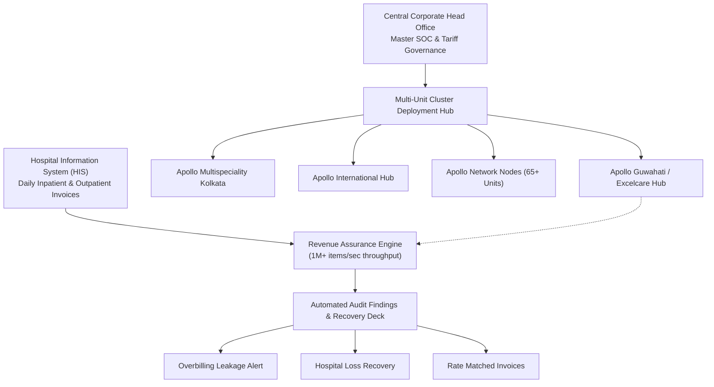

# Apollo Hospitals — Enterprise Revenue Assurance & Tariff Intelligence Engine
### Baseline Version: `v2.5.2 Enterprise Multi-Unit`

[](#)
[](#)
[](#)

---

## Executive Overview
The **Apollo Revenue Assurance & Tariff Intelligence Platform** is a high-throughput, enterprise-grade audit engine designed specifically for Apollo Hospitals Group. It provides automated line-by-line validation of inpatient (IP), outpatient (OP), day-care, and surgical billing against contracted Schedules of Charges (SOC), payer agreements, multi-ward rate multipliers, and corporate tariffs.

### Core Capabilities:
- **Ultra-Fast Rate Validation**: Audits over **1,000,000 line items per second** (~36 million items in 35 seconds).
- **Multi-Unit Deployment Hub**: Centralized head-office governance across all **65+ Apollo Hospital Units** with strict node-level tenant isolation.
- **Statement of Charges (SOC) Ingestor**: Automated parsing, heuristic column mapping, and version-controlled activation of 7,000+ line item master tariff schedules.
- **Leakage & Underbilling Detection**: Instant identification of overcharging (billing compliance risk) and uncaptured billable revenue (hospital financial recovery).
- **Enterprise Azure AD / Microsoft Entra ID SSO**: Out-of-the-box support for SAML 2.0 and OpenID Connect Single Sign-On using corporate Apollo credentials.

---

## System Architecture



---

## Baseline Version `v2.5.2` Specifications

| Attribute | Specification |
| :--- | :--- |
| **Baseline Version** | `v2.5.2 Enterprise Multi-Unit` |
| **Release Build** | `V2.5.2_ENTERPRISE_BASELINE_20261113` |
| **Architecture** | Client-Side High-Throughput Stream Processor + Lightweight Python/REST Backend |
| **Authentication Modes** | 1. Microsoft Azure AD / Entra ID Single Sign-On (SAML 2.0 & OIDC)<br>2. Local RBAC (Auditor, Approver, Administrator, Viewer) with 2FA/OTP |
| **Supported Formats** | Excel (`.xlsx`, `.xls`), CSV, JSON, Tabular HIS Dumps |
| **Default Port** | `8500` (Intranet / Localhost binding `0.0.0.0`) |

---

## Quick Start & Local Execution

### 1. Launch Web Application
Double-click `Start_Webpage.bat` or run:
```bash
python run_server.py
```
Open your browser to:
```text
http://localhost:8500/index.html
```

### 2. Default Auditor & Admin Credentials
| Role | Username | Default Password | Scope |
| :--- | :--- | :--- | :--- |
| **Auditor** | `BRC` | `Brc@2013` | Excelcare Unit Tariff Audit |
| **Approver** | `BRC1` | `Brc@2026` | Audit Approvals & Variance Review |
| **Administrator** | `admin` | `Admin@Excel` | Facility Master Control |
| **Corporate Master** | `admin` | *(Master Hash)* | Global 65+ Units Hub |

---

## Microsoft Azure AD / Entra ID Single Sign-On (SSO)

The platform is pre-configured for Apollo corporate identity. To activate:
1. In `config.json` (or via the portal login setup dialog), configure your Apollo Azure AD parameters:
   ```json
   {
     "AZURE_AD_CONFIG": {
       "enabled": true,
       "tenant_id": "<APOLLO_AZURE_TENANT_ID>",
       "client_id": "<APOLLO_APP_CLIENT_ID>",
       "redirect_uri": "https://<APPLICATION_URL>/index.html",
       "saml_acs_url": "https://<APPLICATION_URL>/api/saml/acs"
     }
   }
   ```
2. Users can simply click **"Sign in with Apollo SSO (Azure AD)"** on the portal login screen.

For complete transfer and Azure AD setup instructions, refer to [APOLLO_HANDOVER_AND_AZURE_AD_SETUP.md](APOLLO_HANDOVER_AND_AZURE_AD_SETUP.md).

---

## Repository Transfer Checklist for Apollo IT
- [x] Baseline Version standardized to `v2.5.2 Enterprise`.
- [x] Automated CI/CD Push Integrity Guard updated for Apollo Organization.
- [x] SAML 2.0 ACS and Azure AD OAuth2 callback endpoints active.
- [x] Test data and multi-ward master tariff files verified in `Test Data/`.
- [x] Ready for GitHub organization transfer via Repository Settings -> Transfer Ownership.
